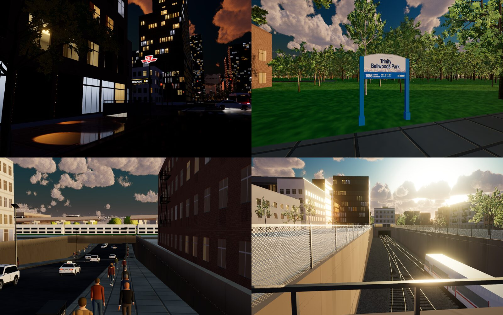
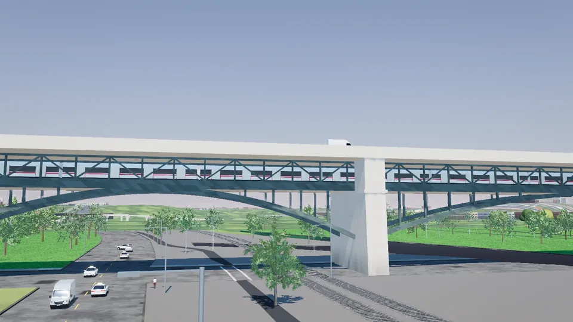
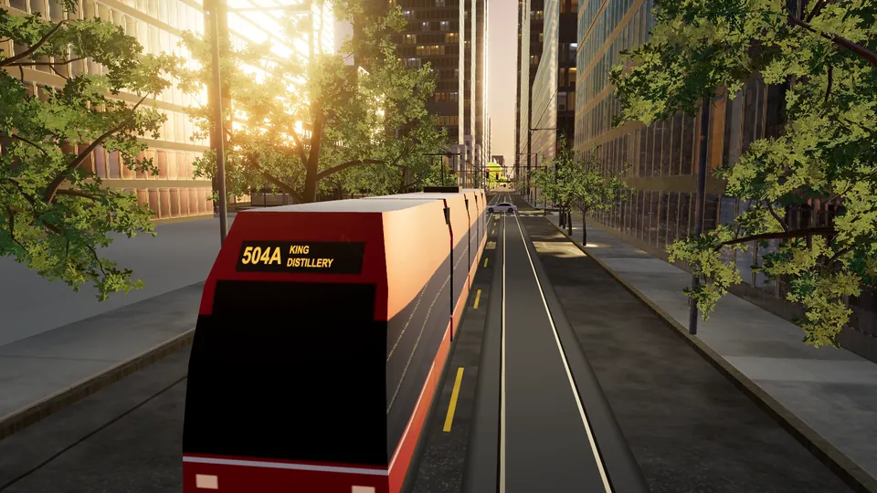
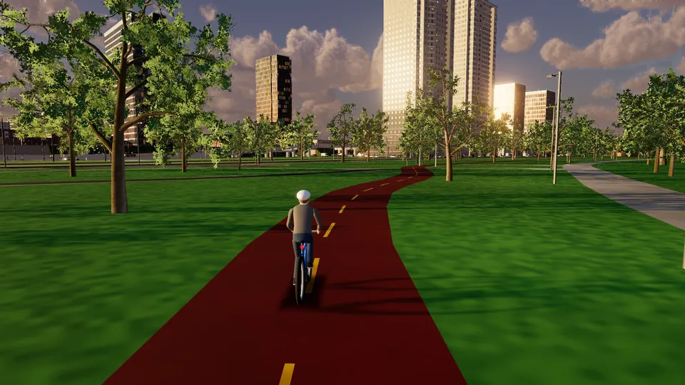

# GTA: THE 6

<p align="center">
  <video src="https://github.com/user-attachments/assets/0cac3828-69fe-4986-ba98-4ebe5a0777a0" width="420" controls></video>
</p>

Explore Toronto in a browser-based open-world game. Walk, cycle, drive, and fly through a detailed 3D city built around
real Toronto streets, landmarks, transit, and waterfront locations.

## Play

**[Play GTA: THE 6](https://gta-the-6.onrender.com/explore.html)**

Recent Chrome or Edge is recommended for WebGPU. Supported browsers can fall back to WebGL2, without volumetric clouds.

## Screenshots and gameplay clips

Scenes from the city, including the Bloor Viaduct, downtown streets, parks, and the subway corridor:



Click a preview to open its gameplay clip:

| TTC subway on the Bloor Viaduct | 504 streetcar | Toronto waterfront |
| --- | --- | --- |
| [](city/assets/site/clips/subway-viaduct.mp4) | [](city/assets/site/clips/streetcar-504.mp4) | [](city/assets/site/clips/waterfront-ride.mp4) |

## Gameplay

- Explore on foot and use the in-game map and minimap to navigate.
- Open the phone with **Arrow Up** or the HUD phone button. **Teleport** travels to places; **Garage** summons a car,
  bicycle, or helicopter.
- Walk up to a vehicle and press **E** to enter. Press **E** again to exit; helicopters must be landed and stopped.
- Ride TTC streetcars and subway trains, visit Toronto landmarks, and adjust time, weather, and settings in the phone.

Controls change by mode. The on-screen hints show the current keyboard, touch, and gamepad controls.

## Toronto in detail

- **Transit:** ride subway routes including Line 2 across the Bloor Viaduct, use 27 street-level stations, and board
  TTC streetcars and GO trains on mapped routes.
- **Street network:** explore Toronto bike lanes, cycle tracks, waterfront trails, intersections, and street furniture.
  Traffic and roughly 10,800 curb-parked cars are placed to reflect the city's parking rules.
- **Local places:** visit the CN Tower, Rogers Centre, parks, public art, and heritage sites in their mapped locations.
- **Changing city:** adjust the time and weather, from bright afternoon to golden hour, rain, snow, and night; traffic,
  streetcars, and the waterfront contribute to the city soundscape.

## Technical overview

The city runs as a client-side Three.js application. `main.js` connects the persistent 3D scene, camera, HUD, traffic,
transit, and user interface. Movement and vehicle control share the existing controller system; the phone calls those
gameplay functions instead of creating a second simulation.

| Area | Main files |
| --- | --- |
| Game entry and UI | `city/explore.html`, `city/js/main.js` |
| Movement, vehicles, and cameras | `city/js/controllers.js`, `city/js/cameras.js` |
| Phone apps and styles | `city/js/phone.js`, `city/css/phone.css` |
| Traffic and transit | `city/js/traffic.js`, `city/js/transit-live.js`, `city/js/transit-buses.js` |
| Static site build | `city/tools/build-site.mjs`, output in `city/dist/` |

Rendering uses Three.js WebGPURenderer and TSL, with a WebGL2 fallback. The browser loads committed Toronto city data;
you do not need to run a separate map-data download step to start the game.

## Run locally

```bash
cd city
npm ci
npm run dev
```

Open the local URL printed by the dev server. The landing page is `/`; the game is `/explore.html`.

Create the static production build with:

```bash
npm run build
```

The build writes the deployable site to `city/dist/`, fingerprints JavaScript and CSS assets, and produces an asset
manifest. For focused controller checks, run `node --test tests/controllers.test.cjs` from `city/`.

## Render deployment

Deploy the current game from the **`car-stains`** branch as a static site. Use these settings:

| Setting | Value |
| --- | --- |
| Root directory | `city` |
| Build command | `npm ci && npm run build` |
| Publish directory | `dist` |
| Start command | None (static site) |

The project has also been served at [sloptoronto.ca](https://sloptoronto.ca/) through Cloudflare. Its Worker served the
static build and `/live/vehicles`, a proxy for TTC vehicle positions. The current Render site serves the static game;
when that Worker endpoint is unavailable, transit falls back to its timetable. The endpoint implementation is in
`city/worker/live.js`.

## Data and credits

The city uses open geospatial data from the [City of Toronto](https://open.toronto.ca/) and
[OpenStreetMap contributors](https://www.openstreetmap.org/copyright). The project code is under the
[MIT License](city/LICENSE); data, models, and third-party components retain their own terms. See
[`city/CREDITS.md`](city/CREDITS.md) for attribution and
[`city/README.md`](city/README.md) for detailed developer notes, tests, and data documentation.

The 3D map and render are [Slop Toronto](https://github.com/johnfewell/slop-toronto) by @johnfewell. The game layer is built on top of that city.
