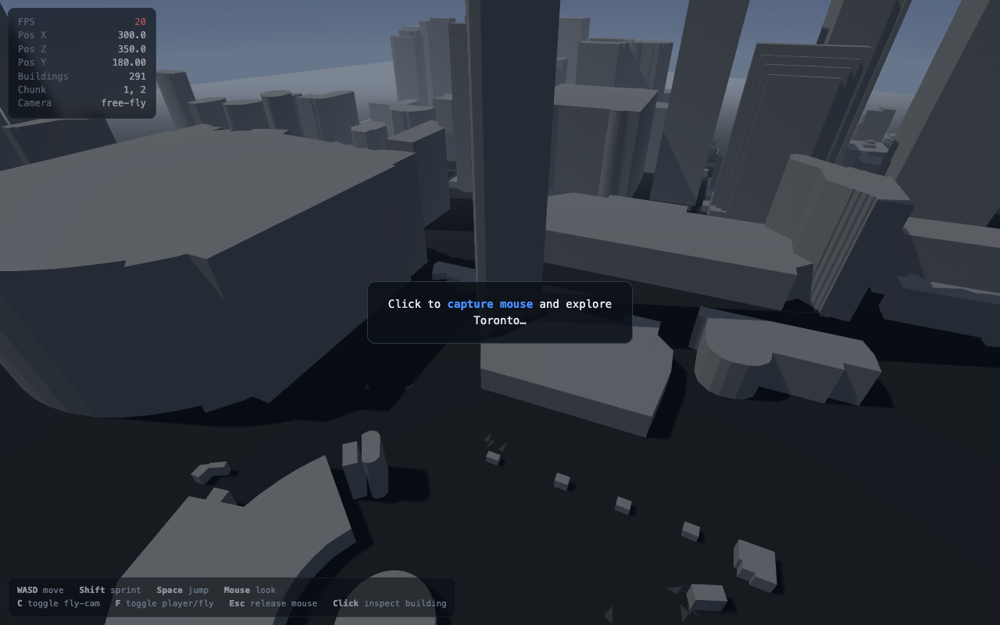

# GTA: THE 6 — Phase 1: Toronto 3D World

An explorable, **geographically accurate** 3D model of downtown Toronto around the
CN Tower, rendered in the browser with Three.js. This is the foundation milestone
for a GTA-style open-world game: real building geometry and street layouts, a
walkable third-person character with collision, and a free-fly debug camera —
**no GTA styling, NPCs, vehicles, missions, or HUD gameplay yet**, by design.

The ~700 m × 700 m playable area covers the **CN Tower, Rogers Centre, and part of
the Entertainment District / downtown core**. Buildings come from the City of
Toronto's official 3D Massing dataset; streets come from OpenStreetMap.



---

## Quick start

```bash
# 1. Install JS deps
npm install

# 2. Get & process the map data (needs Python 3.9+; see "Data pipeline" below)
python3 -m venv .venv && source .venv/bin/activate
pip install -r scripts/requirements.txt
npm run data          # downloads + processes buildings & roads into public/data/

# 3. Run it
npm run dev           # open the printed http://localhost:5173/
```

Click the canvas to capture the mouse, then explore. The processed assets
(`public/data/*.json`) are what the app actually loads — step 2 regenerates them.

> The repo ships without the large raw data and the generated assets (both are
> git-ignored). `npm run data` recreates everything. If you clone and skip it,
> the app will show a friendly "run the data pipeline" message.

---

## Controls

| Input | Action |
| --- | --- |
| **W A S D** | Move (relative to camera) |
| **Mouse** | Look / rotate camera |
| **Shift** | Sprint |
| **Space** | Jump (on foot) / ascend (fly-cam) |
| **C** or **F** | Toggle between third-person and free-fly debug camera |
| **Q** | Descend (fly-cam) |
| **G** | Cycle graphics quality (high / medium / low) |
| **L** | Toggle landmark debug (labels, footprint outlines, bounds) |
| **T** | Teleport the fly-cam to frame the CN Tower + Rogers Centre |
| **Esc** | Release the mouse pointer |
| **Click a building** | Inspect its source metadata (ID, height, data source) |

You spawn in the open plaza just south-east of the CN Tower, facing the skyline.

---

## What's in the world

- **Real building geometry** — 291 buildings in the area, extruded to their real
  heights (the CN Tower massing is ~443 m, Rogers Centre, and the surrounding
  towers all sit in their true positions, scale, and orientation).
- **Real streets** — ~520 OpenStreetMap ways (roads, service lanes, footpaths)
  rendered as flat ribbons following the actual Toronto street geometry.
- **Category-aware facades** — OSM building tags enrich the Toronto footprints
  with architectural categories and names; height-based categories remain as the
  fallback where no nearby OSM building matches.
- **Street View comparison** — press **V** to open a developer panel at the
  current world position, with a link to the corresponding Google Street View.
- **Tiled PBR surfaces** — CC0 ambientCG asphalt and concrete color, normal, and
  roughness maps detail roads and paths; concrete color textures the ground and
  brick albedo adds facade detail.
- Flat grey ground, dark-asphalt roads, lighter concrete footpaths.
- A single shadow-casting "sun", soft hemisphere fill, gradient sky, and
  distance fog tuned to the play area.
- A capsule placeholder character with gravity, jumping, ground collision, and
  **building collision** (you can't walk through buildings or fall through the
  ground).

### Landmarks

Recognizable landmarks are hand-built, original low-poly models placed at their
real geographic locations, replacing the generic extrusion that would otherwise
stand there:

- **CN Tower** (~553 m) — tapered hexagonal shaft on three legs, main observation
  pod, SkyPod, and antenna mast. Placed at OSM way/32742038, aligned to 3D Massing
  building `tor3dm-00218`.
- **Rogers Centre** — elliptical seating bowl with a segmented low-profile
  retractable dome, scaled from the real stadium footprint (`tor3dm-00216`), just
  south-west of the tower.

Each landmark is driven by a small **override registry** (`src/landmarks/`): a
name, OSM/source id, geographic location, footprint, a model factory, collision
geometry, and metadata. When an override is present the matching generic
building(s) and their colliders are **suppressed** so nothing overlaps, and the
landmark adds its own footprint collider to the shared collision grid. The generic
building renderer stays the fallback for everything else.

Models are intentionally light (CN Tower ~550 tris, Rogers Centre ~2,000 tris) and
built from Three.js primitives — **no third-party assets are copied**. See
[`data/LANDMARK_SOURCES.md`](data/LANDMARK_SOURCES.md) for the reference models,
creators, licences, and which landmarks fall outside the current map bounds.

Press **L** for landmark debug (labels + footprint outlines + bounds) and **T** to
teleport the fly-cam to a vantage framing both landmarks.

### Realistic rendering

Clear-midday graphics: a physical sky with image-based lighting, glass/window
facade shading on the towers, ambient occlusion, subtle bloom, SMAA anti-aliasing,
textured asphalt with lane markings, and Lake Ontario water to the south. Rendering
is capped at 30 fps to keep GPU cost down; press **G** to drop to medium/low if a
machine struggles (low bypasses post-processing entirely).

### Debug overlay (top-left)

FPS · player X/Z/Y · number of loaded buildings · current map chunk · camera mode ·
graphics quality.
Click any building to open the inspector (top-right) with its building ID, height,
base elevation (MSL), and the height/building data sources from the Toronto dataset.

---

## Data sources & attribution

See [`data/ATTRIBUTION.md`](data/ATTRIBUTION.md) for full detail.

- **Buildings:** [City of Toronto Open Data — 3D Massing](https://open.toronto.ca/dataset/3d-massing/)
  (`3DMassingShapefile_2025_WGS84`). Licensed under the
  **Open Government Licence – Toronto**. *Contains information licensed under the
  Open Government Licence – Toronto.*
- **Roads:** [OpenStreetMap](https://www.openstreetmap.org/) via the Overpass API.
  **© OpenStreetMap contributors**, licensed under the **ODbL**.

> Note: despite the "WGS84" filename, the 3D Massing shapefile's geometry is in
> **EPSG:3857 (Web Mercator)**. The pipeline reprojects it correctly — see below.

---

## Data pipeline

Two small, dependency-light Python scripts turn raw open data into compact,
browser-ready assets. They are designed to be **repeatable** and **expandable**.

```
scripts/
  config.py          # area bounds, projection math, source URLs (edit this to move/resize)
  download_data.py   # caches raw buildings (shapefile) + roads (OSM/Overpass) in data/raw/
  process_data.py    # clips, reprojects, chunks, and writes public/data/*.json
  requirements.txt   # just pyshp (pure Python — no GDAL/GEOS needed)
```

**Pipeline stages** (`process_data.py`):

1. **Clip** source data to the 700 m playable area around the CN Tower.
2. **Reproject** geometry into local Three.js **metres** — an equirectangular
   tangent plane centred on the area (sub-metre accurate over <1 km, so no heavy
   GIS dependency is required). Buildings pass Web Mercator → lon/lat → local metres.
3. **Buildings** → flat footprint rings + height (extruded at runtime in-browser).
4. **Roads** → centre-line polylines + width (ribboned at runtime).
5. **Chunking** — every feature is tagged with a spatial chunk (175 m grid) so the
   renderer can group geometry and the map can grow later.
6. **Metadata** — stable per-building IDs plus height/elevation/source fields are
   preserved for the inspector.

**Outputs** (`public/data/`, served directly by Vite):

| File | Contents |
| --- | --- |
| `manifest.json` | area bounds, spawn point, chunk size, counts, attribution |
| `buildings.json` | `{ id, h, b, hs, bs, cat, catName, osm, name, chunk, rings:[[x,z,…]] }` per building |
| `roads.json` | `{ id, cls, width, name, chunk, pts:[x,z,…] }` per road |
| `sources.json` | per-building geometry/tag provenance and license notes |

Coordinate convention: **local metres, +x = east, +z = south, origin at the area
centre.** World units are metres everywhere.

### Fallbacks

- The public Overpass API is frequently overloaded. `download_data.py` tries
  several mirrors in order and falls back to the main endpoint, with backoff. If
  **all** fail, processing still runs and emits an empty road set so the city
  (buildings + ground) is still explorable; just re-run `npm run data:download`
  later to add streets.
- Building heights fall back across `MAX_HEIGHT → AVG_HEIGHT → MIN_HEIGHT`, with a
  3 m floor for degenerate/zero values.

---

## Expanding the map to more of Toronto

The rendering system is data-driven and chunked, so growing the map **does not**
require touching renderer code:

1. In `scripts/config.py`, enlarge `AREA_SIZE_M` (and/or move `AREA_CENTER_LAT/LON`).
2. Re-run `npm run data`. The buildings script scans the full city dataset and
   clips to the new box; the roads script re-queries Overpass for the new bbox.
3. Reload — the new buildings/roads/chunks load automatically.

Because features are already grouped per spatial chunk, the natural next step for
much larger areas is to **stream chunks on demand** (load/unload merged chunk
meshes around the player) rather than loading everything up front. The data format
and chunk tags are built for that; only `src/main.ts`/`src/buildings.ts` would need
a small streaming layer added.

To extend to brand-new neighbourhoods you can also run multiple boxes and merge
the outputs — the IDs are namespaced (`tor3dm-…`, `osm-…`) and coordinates are all
in the same local frame.

---

## Performance notes

- **Draw calls are minimised:** buildings are merged into one mesh **per chunk**
  (~24 meshes), roads into 2 meshes (asphalt + paths), plus ground/sky/player.
- Geometry is extruded once at load and cached; collision uses a separate, cheap
  2D polygon representation in a spatial-hash grid (rendering vs collision geometry
  kept separate).
- A single 2048² shadow map covers the play area; pixel ratio is capped at 2.
- The assets are tiny (buildings ≈ 116 KB, roads ≈ 81 KB) and load instantly.

Runs comfortably at 60 fps on a modern laptop GPU. (Automated verification runs in
headless SwiftShader software rendering, where ~20 fps is expected.)

---

## Project structure

```
index.html              # canvas, HUD, inspector, help, loading screen (markup + CSS)
src/
  main.ts               # bootstrap, game loop, camera-mode switching
  assets.ts             # fetches manifest / buildings / roads
  types.ts              # data contracts shared with the pipeline
  environment.ts        # sky, fog, lights, shadows, ground
  buildings.ts          # runtime extrusion, per-chunk merging, pick mapping
  roads.ts              # road/path ribbon meshes
  collision.ts          # 2D circle-vs-polygon collision + spatial grid
  player.ts             # third-person character, gravity/jump, orbit camera
  flyCamera.ts          # free-fly debug camera
  input.ts              # keyboard + pointer-lock mouse
  hud.ts                # debug overlay updates
  inspector.ts          # click-to-inspect building picking + highlight
scripts/
  config.py, download_data.py, process_data.py, requirements.txt
  verify_browser.mjs    # headless smoke test (npm run verify)
  verify_functional.mjs # headless collision + picking test (npm run verify:functional)
data/
  ATTRIBUTION.md        # data sources & licences
  raw/                  # cached raw downloads (git-ignored)
public/data/            # generated browser assets (git-ignored)
```

## Verification

```bash
npm run dev            # in one terminal
npm run verify         # headless: loads the app, checks it built, screenshots it
npm run verify:functional   # headless: asserts collision push-out + building picking
```

`npm run verify` requires Google Chrome installed (it drives it via `puppeteer-core`).
